
<picture>
  <source media="(prefers-color-scheme: dark)" srcset="assets/banner-dark.png">
  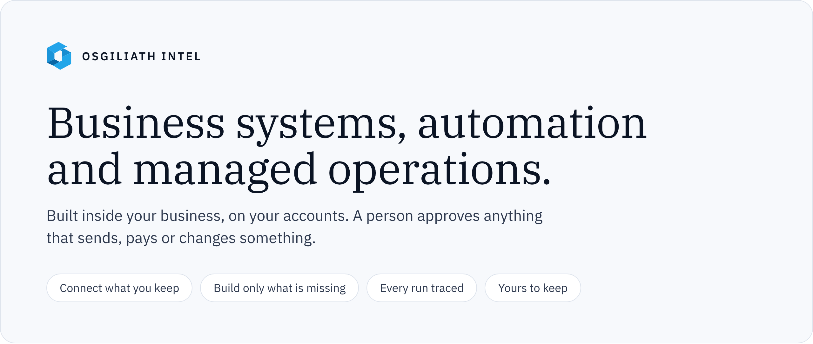
</picture>

  
  
  

<a href="#see-it-running">See it running</a> · <a href="#several-models-one-task">Several models</a> · <a href="#your-business-mapped">Business maps</a> · <a href="#department-by-department">Departments</a> · <a href="#how-we-run-our-own-business">How we run</a> · <a href="#services">Services</a> · <a href="examples/README.md">Example runs</a>

This repository is our shop window. It explains what we build, how a run flows through a business, and where to start. It holds no client work and no client data: every example is made up and says so.

## Quick start

1. **Model your business, free.** See what you have, what is missing and where we would start: [osgiliathintel.co.uk/model-your-business](https://osgiliathintel.co.uk/model-your-business)
2. **Find out.** A Systems Health Check on one workflow or system.
3. **Fix one thing.** A bounded sprint, ending in something you own.

Each step is scoped and quoted on its own. We never sell a plan to modernise the whole business.

## How every system is shaped

<picture>
  <source media="(prefers-color-scheme: dark)" srcset="assets/flow-dark.png">
  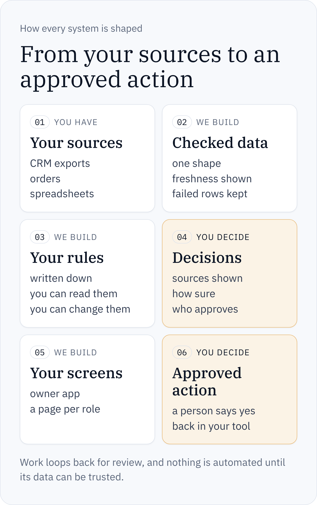
</picture>

Six layers, in order. The two marked steps are where a person decides. Work loops back for review, and nothing is automated until its data can be trusted.

<picture>
  <source media="(prefers-color-scheme: dark)" srcset="assets/ui/layers-dark.jpg">
  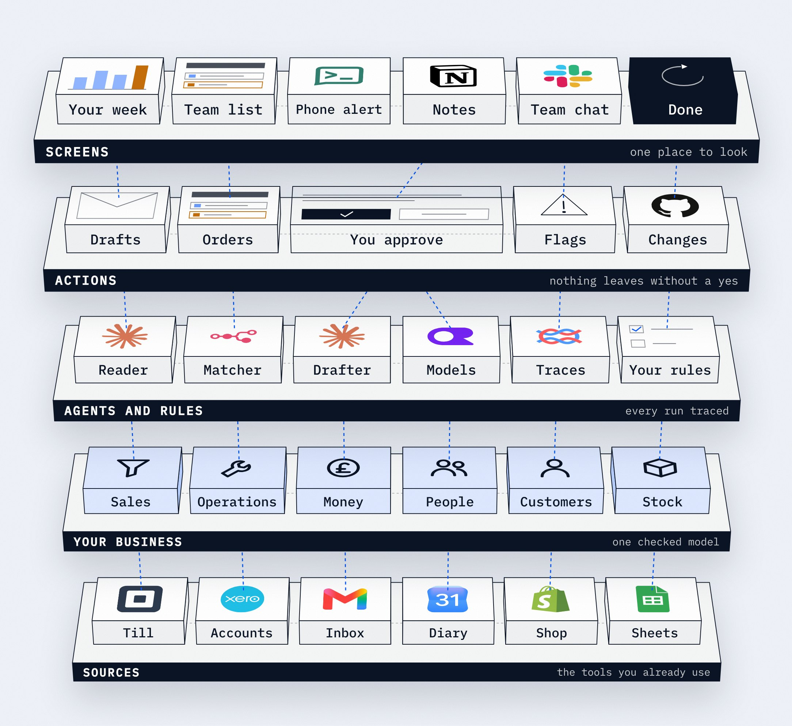
</picture>

The same shape, drawn as one made-up business: the tools it already uses at the bottom, one checked model of its departments, the agents and rules that do the work, the actions that wait for a yes, and the screens its people use.

## How we work with you

| | |
| --- | --- |
| **We work alongside you** | You work with the person who builds it, and they work with the people who run the work each day. |
| **We connect what you keep** | We map what you have, show the gaps, connect what you keep and build only what is missing. |
| **It runs on your accounts** | The software runs on your own accounts. Your data stays in your systems, or a workspace that is yours alone. |
| **For you, then with you** | We build it for you, then hand it over, or keep running it with you on a managed basis. |

## Services

| Step | Package | When it fits |
| --- | --- | --- |
| Find out | Systems Health Check | Something in a workflow or system is wasteful or unreliable, and nobody can say exactly what. |
| Find out | Systems Opportunity Audit | Several tools and processes do not join up, and you need a proper plan. |
| Fix one thing | Website + CRM Launch | Enquiries need to move reliably from your website into sales. |
| Fix one thing | Workflow Rescue Sprint | One recurring manual job is painful or keeps going wrong. |
| Fix one thing | Management Visibility Sprint | You cannot see, or cannot trust, a key part of the business. |
| Build the layer | Operating Layer Build | Several systems and teams need one controlled way of working. |
| Build the layer | Decision System | A forecast or decision you make again and again is weak. |
| Keep it running | Managed Systems | What has been built needs keeping healthy and improving. |

Services by department (marketing, sales, finance, people, technology and more): [osgiliathintel.co.uk/services/departments](https://osgiliathintel.co.uk/services/departments)

## Products: software you get a copy of

- **The owner interface.** One screen to see what your system is doing and to approve what it wants to do.
- **The pipeline library.** Workflows by department, each one traced, each with the step where a person decides.
- **The automation modules.** Building blocks with their own tests: an approval gate, lead intake, invoice chasing, research and qualifying, follow-up, and a digest of signals.
- **The estate kit.** Your accounts, cloud, AI models and monitoring, set up the same way every time, in your name.
- **The tracing and cost layer.** Every run, model call and decision recorded, with what it cost.

## See it running

One department's run, played on the owner's screen. Each step goes to whatever suits it: an automation, fixed rules, an agent on a small or a stronger model, or a person. It stops for a person's yes, and every step lands on the trace.

<picture>
  <source media="(prefers-color-scheme: dark)" srcset="assets/ui/run-dark.gif">
  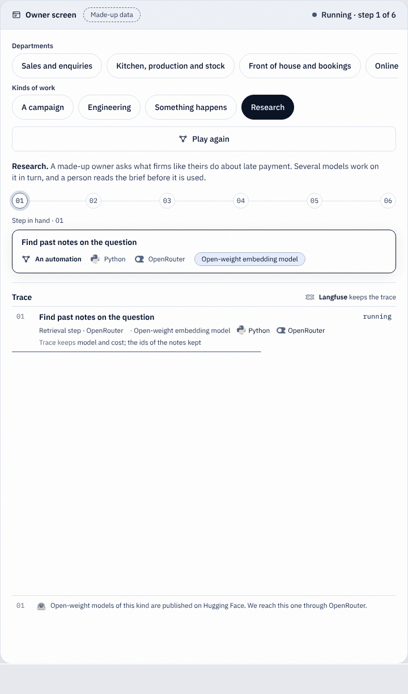
</picture>

Made-up data. More runs (a campaign, engineering, something happening in the system): [examples](examples/README.md).

## Several models, one task

<picture>
  <source media="(prefers-color-scheme: dark)" srcset="assets/ui/severalmodels-dark.jpg">
  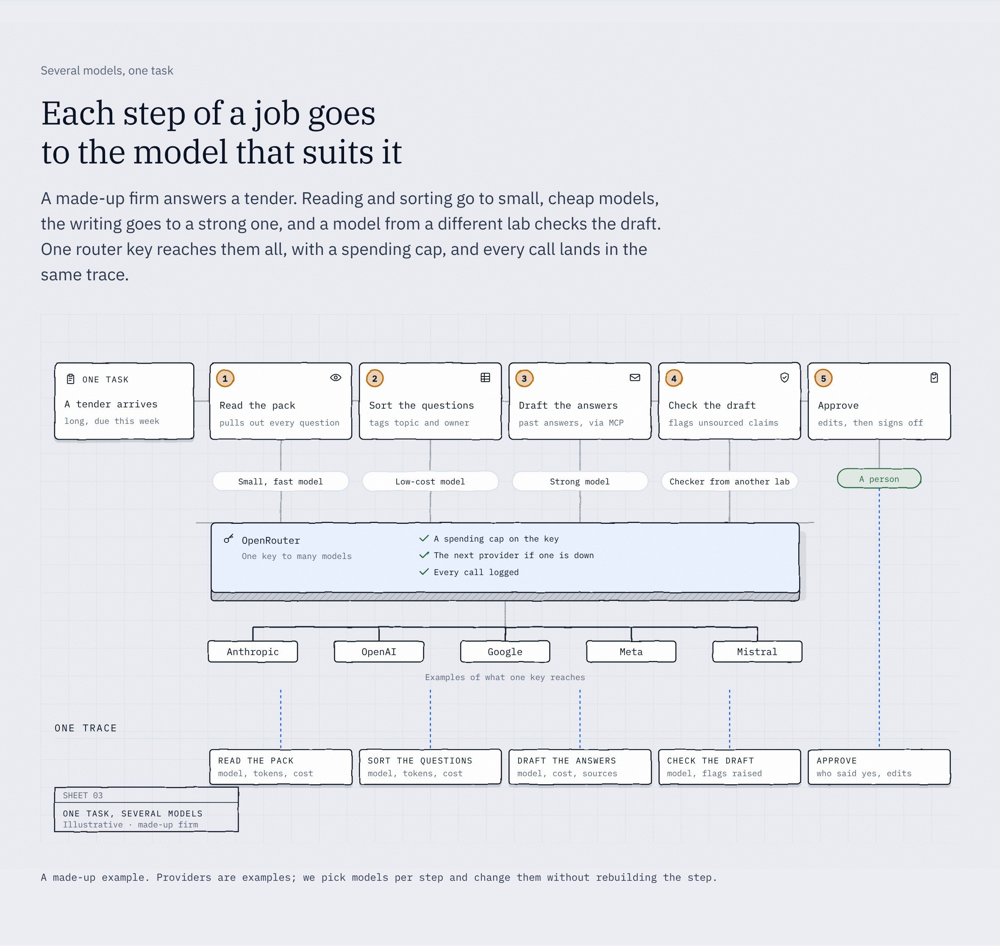
</picture>

## Agents on a harness, around the software a team already runs

<picture>
  <source media="(prefers-color-scheme: dark)" srcset="assets/ui/engine-dark.jpg">
  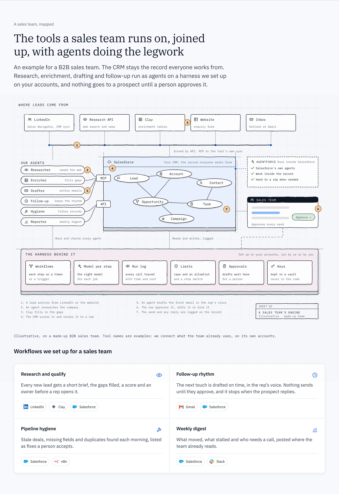
</picture>

Illustrative, on a made-up team. Tool names are examples: we connect what a team already uses, on its own accounts.

## Your business, mapped

Every system you already run feeds one model of your business. Each team reads the same records.

<picture>
  <source media="(prefers-color-scheme: dark)" srcset="assets/ui/bizmap-dark.jpg">
  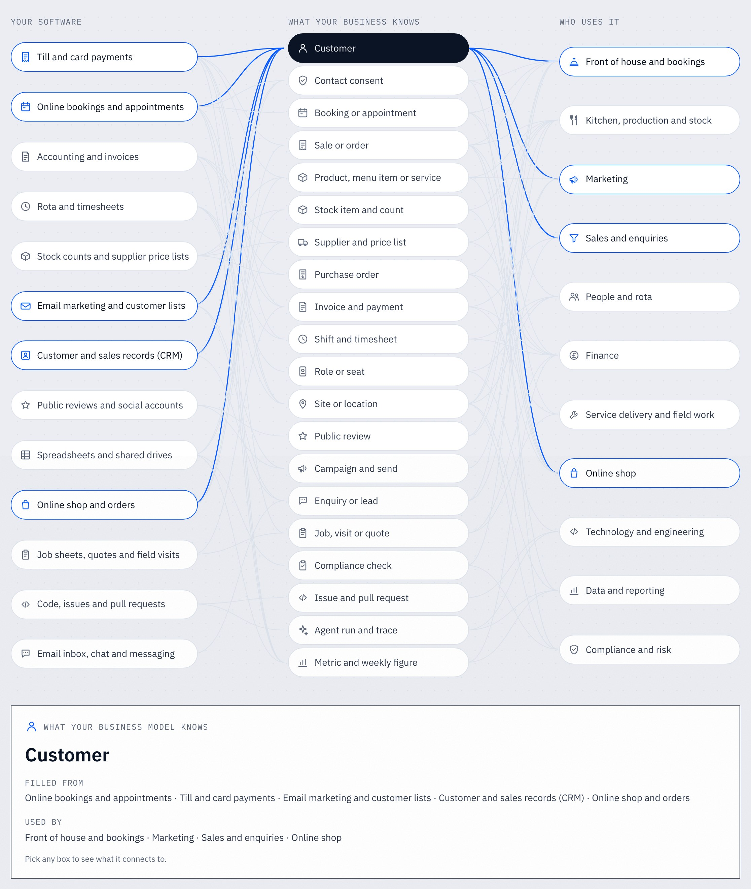
</picture>

<picture>
  <source media="(prefers-color-scheme: dark)" srcset="assets/ui/connect-dark.jpg">
  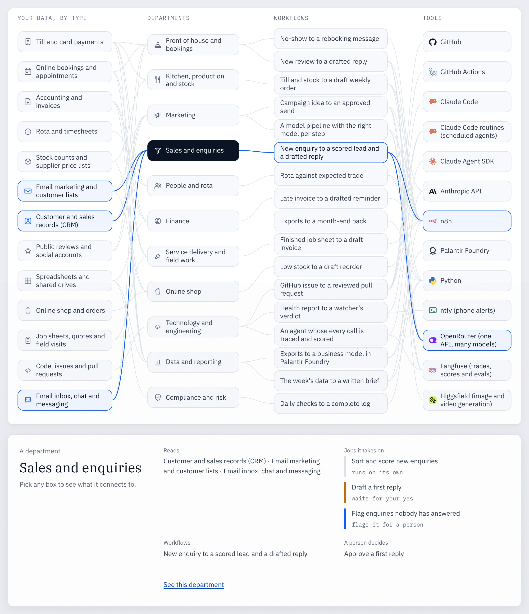
</picture>

## Department by department

<picture>
  <source media="(prefers-color-scheme: dark)" srcset="assets/ui/departments-dark.jpg">
  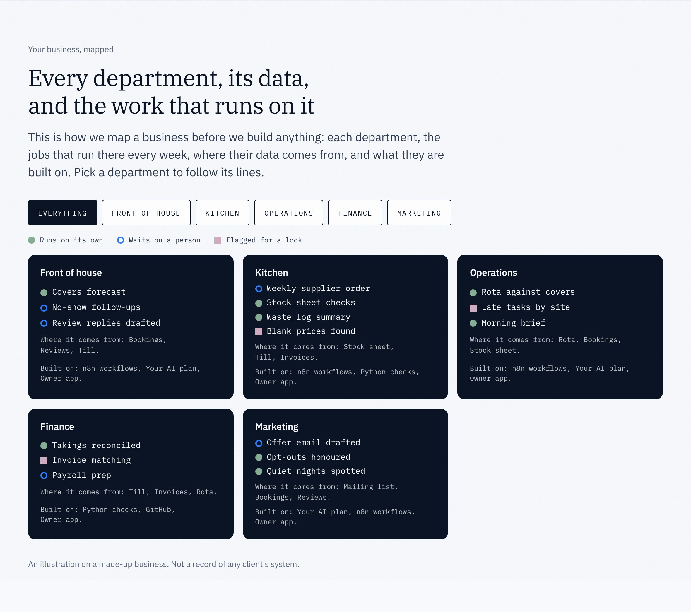
</picture>

## Workflows by kind of business

<picture>
  <source media="(prefers-color-scheme: dark)" srcset="assets/ui/directory-dark.jpg">
  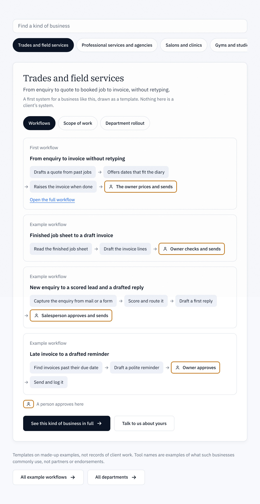
</picture>

## Ecosystem: keep what you use, we build and connect the rest

We set up whichever tools you prefer or already run, and build what is missing around them. Four ways in: **keep** the software you have, **upgrade** when an old tool holds you back, **build or buy** where nothing fits, and **add agents** on top, from templates, with a person approving.

<picture>
  <source media="(prefers-color-scheme: dark)" srcset="assets/ui/library-dark.jpg">
  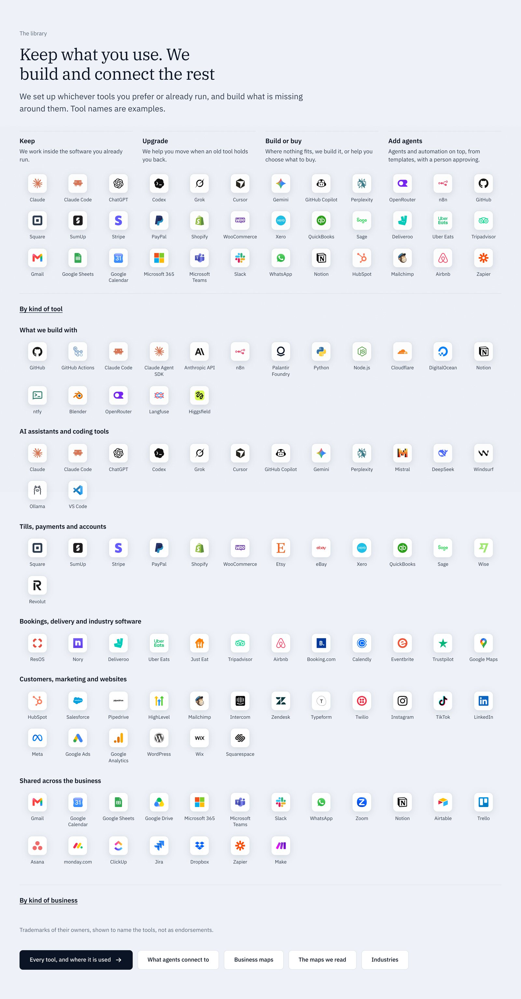
</picture>

Tool names are examples of each kind. Marks are their owners' trademarks, shown only to name the tools, not as endorsements.

### By kind of business

What each kind of business usually runs, with example tools for each need. Whichever assistant or model you prefer sits on top.

<picture>
  <source media="(prefers-color-scheme: dark)" srcset="assets/ui/bybusiness-dark.jpg">
  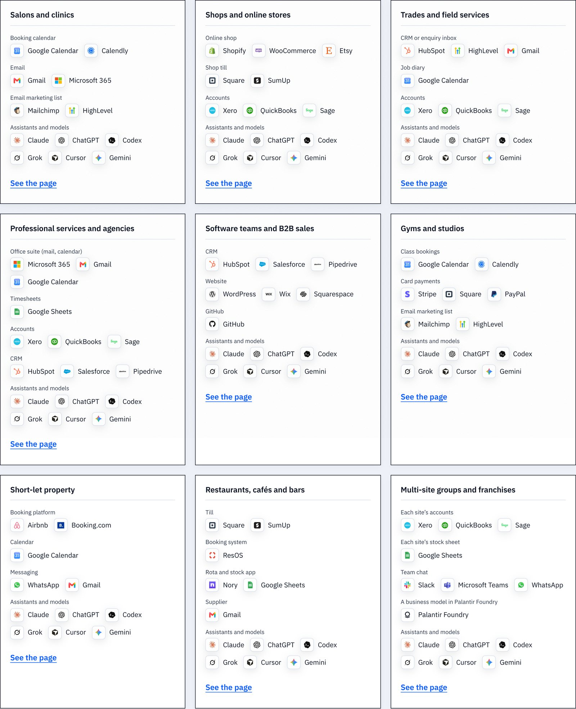
</picture>

### Sales and marketing as one line

From first contact to a counted result: find and research, CRM, ads, social channels, landing pages, emails, measure. Agents research, draft and tidy at each stage. A person approves anything that sends or spends.

<picture>
  <source media="(prefers-color-scheme: dark)" srcset="assets/ui/line-dark.jpg">
  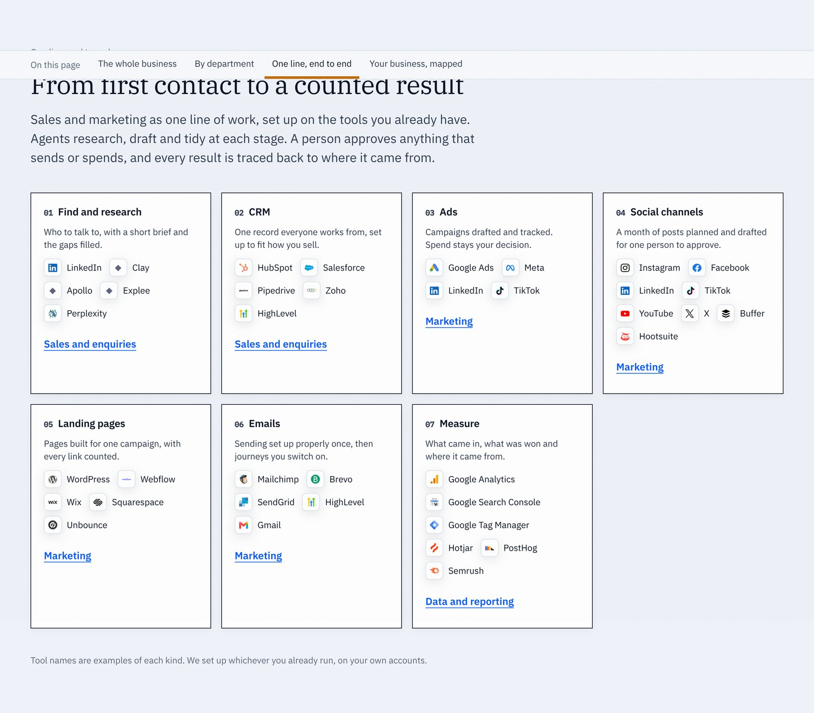
</picture>

### What we build with

| Job | Tools |
| --- | --- |
| Agents | Claude Code, Claude Code routines, Claude Agent SDK |
| Models | Anthropic API; OpenRouter (one key to many models, with a spending cap) |
| Workflows | n8n |
| Traces, scores and cost | Langfuse |
| Data | Your own exports and APIs |
| Code and checks | GitHub, GitHub Actions, Python, Node.js, Playwright |
| Hosting | Cloudflare, DigitalOcean |
| Alerts | ntfy (phone alerts) |
| Images and video | Higgsfield, Blender |

We connect to the systems you already run, named by type on our site: CRM, orders, spreadsheets, accounts, bookings. We also work with Palantir Foundry where a business runs it.

## How we run our own business

Before we build one for you, we build it for ourselves. Osgiliath runs its own work the way it builds systems for clients: checked first, reviewed, and approved by a person before anything goes live.

<picture>
  <source media="(prefers-color-scheme: dark)" srcset="assets/ui/ownstack-dark.jpg">
  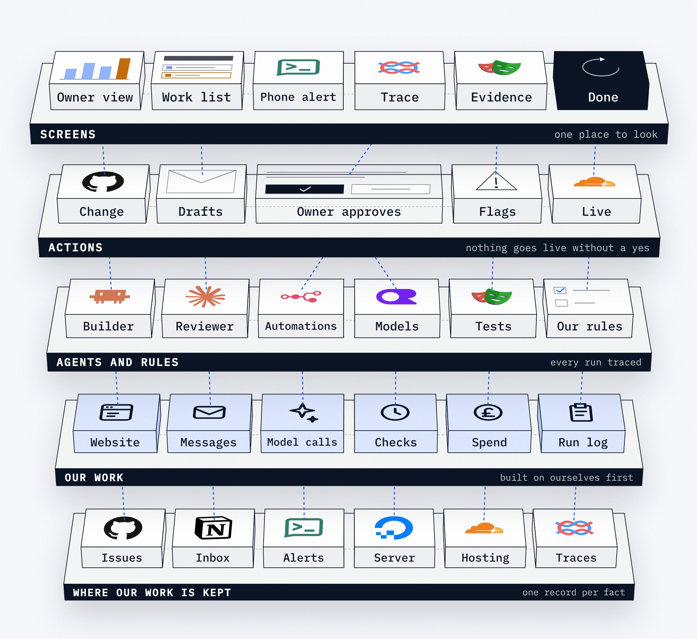
</picture>

| | |
| --- | --- |
| **Checked on every change** | Each change starts on its own branch. Types, tests and the build run automatically, and browser tests and screenshots of every page run before review. |
| **Reviewed separately** | A separate AI reviewer reads each change from scratch before a person looks at it. |
| **Approved before it goes live** | Nothing is published until a person approves the evidence. Our website is released that way. |
| **Runs you can replay** | We are building our pipelines to record each run step by step: which agent, model and tool did what, what it cost, and where it waited for a person. |

Four of our own pipelines, step by step, with the point where a person decides marked. Three run today; the fourth is built and tested, and its card says so.

<picture>
  <source media="(prefers-color-scheme: dark)" srcset="assets/ui/ownflows-dark.jpg">
  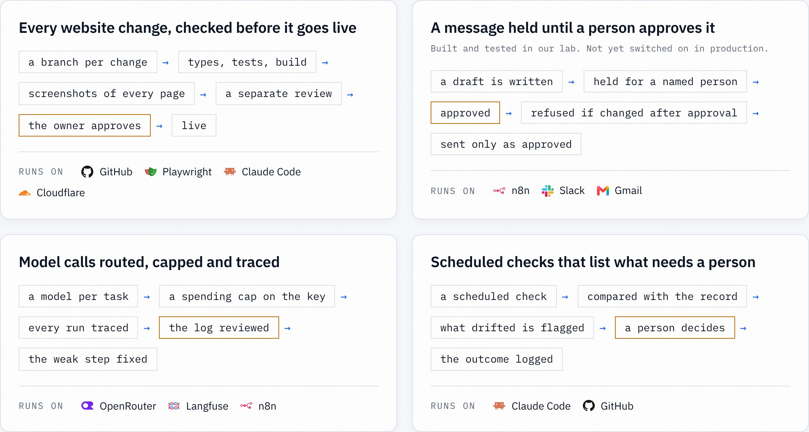
</picture>

## Ground rules

- A person approves anything that sends, pays or changes something.
- No invented results. If we have not measured it, we do not claim it.
- Your data stays in your systems. Nothing of yours appears here.

## Licence and contact

The text in this repository is © Osgiliath Intel Ltd. Tool names are trademarks of their owners, shown to name the tools, not as endorsements.

Osgiliath Intel Ltd · registered in England and Wales · company number 17375070
[osgiliathintel.co.uk](https://osgiliathintel.co.uk) · [Get in touch](https://osgiliathintel.co.uk/contact)
