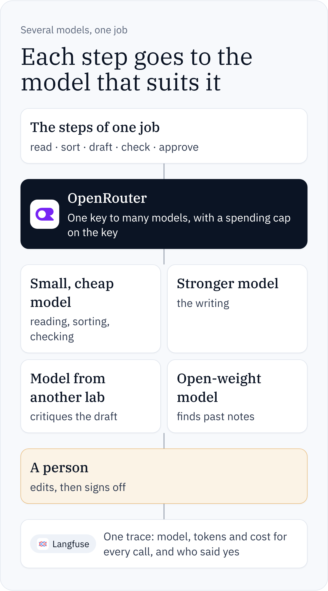
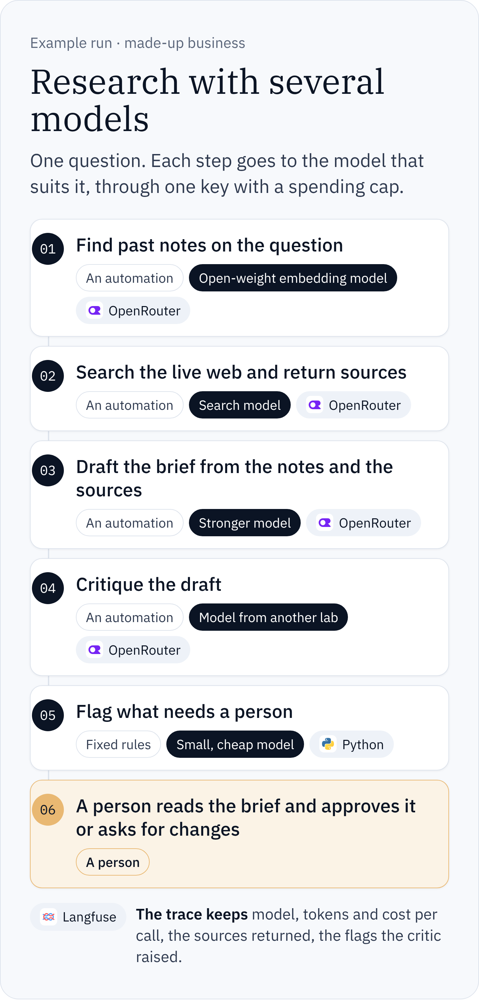

<picture>
  <source media="(prefers-color-scheme: dark)" srcset="assets/banner-dark.png">
  
</picture>

  
  
  

This repository is our shop window. It explains what we build, how a run flows through a business, and where to start. It holds no client work and no client data: every example is made up and says so.

## Quick start

1. **Model your business, free.** See what you have, what is missing and where we would start: [osgiliathintel.co.uk/model-your-business](https://osgiliathintel.co.uk/model-your-business)
2. **Find out.** A Systems Health Check on one workflow or system.
3. **Fix one thing.** A bounded sprint, ending in something you own.

Each step is scoped and quoted on its own. We never sell a plan to modernise the whole business.

## How every system is shaped

<picture>
  <source media="(prefers-color-scheme: dark)" srcset="assets/flow-dark.png">
  
</picture>

Six layers, in order. The two marked steps are where a person decides. Work loops back for review, and nothing is automated until its data can be trusted.

## How we work with you

| | |
| --- | --- |
| **We work alongside you** | You work with the person who builds it, and they work with the people who run the work each day. |
| **We connect what you keep** | We map what you have, show the gaps, connect what you keep and build only what is missing. |
| **It runs on your accounts** | The software runs on your own accounts. Your data stays in your systems, or a workspace that is yours alone. |
| **For you, then with you** | We build it for you, then hand it over, or keep running it with you on a managed basis. |

## Services

| Step | Package | When it fits |
| --- | --- | --- |
| Find out | Systems Health Check | Something in a workflow or system is wasteful or unreliable, and nobody can say exactly what. |
| Find out | Systems Opportunity Audit | Several tools and processes do not join up, and you need a proper plan. |
| Fix one thing | Website + CRM Launch | Enquiries need to move reliably from your website into sales. |
| Fix one thing | Workflow Rescue Sprint | One recurring manual job is painful or keeps going wrong. |
| Fix one thing | Management Visibility Sprint | You cannot see, or cannot trust, a key part of the business. |
| Build the layer | Operating Layer Build | Several systems and teams need one controlled way of working. |
| Build the layer | Decision System | A forecast or decision you make again and again is weak. |
| Keep it running | Managed Systems | What has been built needs keeping healthy and improving. |

Services by department (marketing, sales, finance, people, technology and more): [osgiliathintel.co.uk/services/departments](https://osgiliathintel.co.uk/services/departments)

## Products: software you get a copy of

- **The owner interface.** One screen to see what your system is doing and to approve what it wants to do.
- **The pipeline library.** Workflows by department, each one traced, each with the step where a person decides.
- **The automation modules.** Building blocks with their own tests: an approval gate, lead intake, invoice chasing, research and qualifying, follow-up, and a digest of signals.
- **The estate kit.** Your accounts, cloud, AI models and monitoring, set up the same way every time, in your name.
- **The tracing and cost layer.** Every run, model call and decision recorded, with what it cost.

## Example runs

Made-up businesses, real shapes. Each step goes to whatever suits it: an automation, fixed rules, an agent on a small or a stronger model, or a person.

<picture>
  <source media="(prefers-color-scheme: dark)" srcset="assets/models-dark.png">
  
</picture>

| Run | What it shows |
| --- | --- |
| [A campaign](examples/README.md#a-campaign) | An idea becomes drafts for each channel, checked for consent and brand, sent only after the owner says yes |
| [Engineering](examples/README.md#engineering) | A GitHub issue becomes a reviewed pull request; a person approves what touches the live system |
| [Something happens](examples/README.md#something-happens) | A health report becomes a watcher's verdict and an alert on a phone |
| [Research](examples/README.md#research-with-several-models) | One question, several models: a search model with sources, a critic from another lab, a cheap check, a person |

<picture>
  <source media="(prefers-color-scheme: dark)" srcset="assets/run-research-dark.png">
  
</picture>

Follow a pipeline step by step on the site: [osgiliathintel.co.uk/tracing](https://osgiliathintel.co.uk/tracing)

## Ecosystem: what we build with

| Job | Tools |
| --- | --- |
| Agents | Claude Code, Claude Code routines, Claude Agent SDK |
| Models | Anthropic API; OpenRouter (one key to many models, with a spending cap) |
| Workflows | n8n |
| Traces, scores and cost | Langfuse |
| Data | Palantir Foundry; your own exports and APIs |
| Code and checks | GitHub, GitHub Actions, Python, Node.js, Playwright |
| Hosting | Cloudflare, DigitalOcean |
| Alerts | ntfy (phone alerts) |
| Images and video | Higgsfield, Blender |

We connect to the systems you already run, named by type on our site: CRM, orders, spreadsheets, accounts, bookings.

## Ground rules

- A person approves anything that sends, pays or changes something.
- No invented results. If we have not measured it, we do not claim it.
- Your data stays in your systems. Nothing of yours appears here.

## Licence and contact

The text in this repository is © Osgiliath Intel Ltd. Tool names are trademarks of their owners, shown to name the tools, not as endorsements.

Osgiliath Intel Ltd · registered in England and Wales · company number 17375070
[osgiliathintel.co.uk](https://osgiliathintel.co.uk) · [Get in touch](https://osgiliathintel.co.uk/contact)
