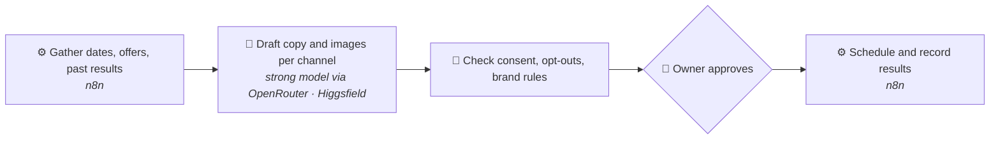
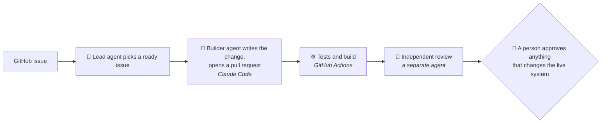
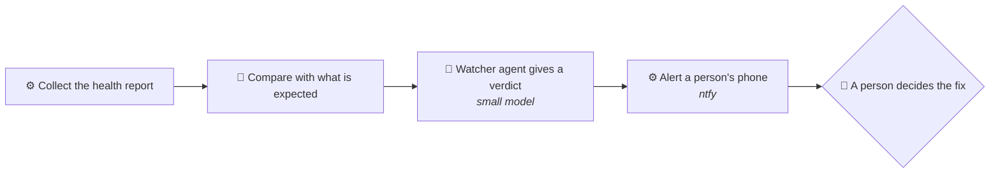
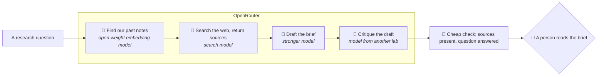

# Example runs

Every business here is made up. The shapes are the ones we set up and run.

Legend: ⚙️ automation · 📏 fixed rules · 🤖 agent (model class shown) · 🧑 a person

## A campaign

A made-up café plans next month's posts.

**The trace keeps:** which model wrote each draft and what it cost, which rules ran, who said yes and what they edited.

## Engineering

A made-up firm wants a change to its own system.

**The trace keeps:** the issue, every commit, the checks, the review verdict and the approval.

## Something happens

A scheduled health report comes in from a live system.

**The trace keeps:** the report, the verdict and its reasons, when the alert went, what was decided.

## Research with several models

One question, each step on the model that suits it, all through one router key with a spending cap.

**The trace keeps:** model, tokens and cost per call, the sources returned, the flags the critic raised (Langfuse).

Open-weight models, such as the embedding model in the first step, are the kind published on Hugging Face. We reach ours through the router; we do not host or train models.
