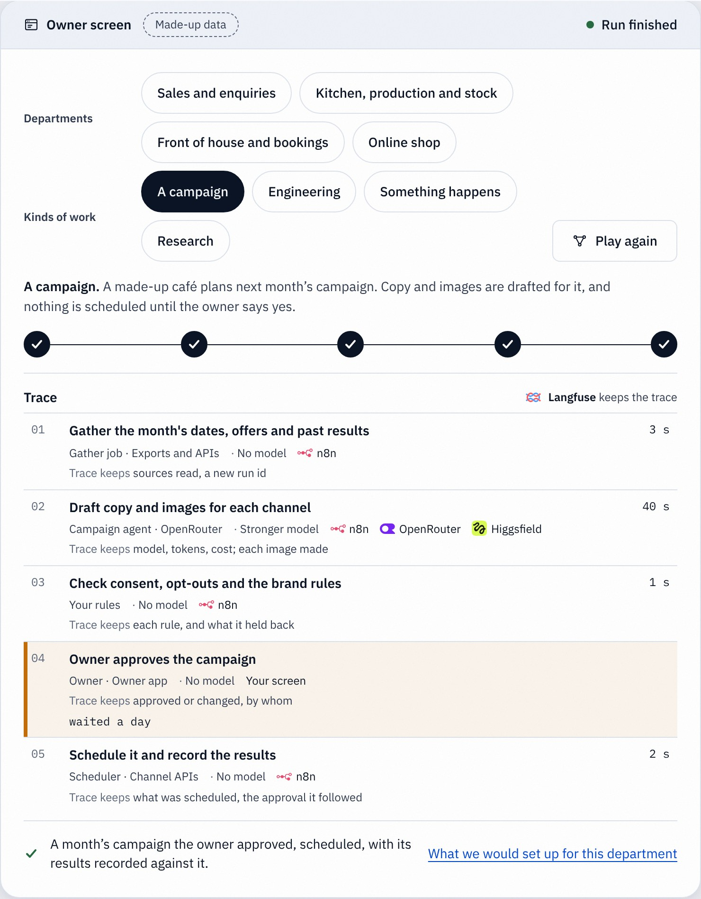
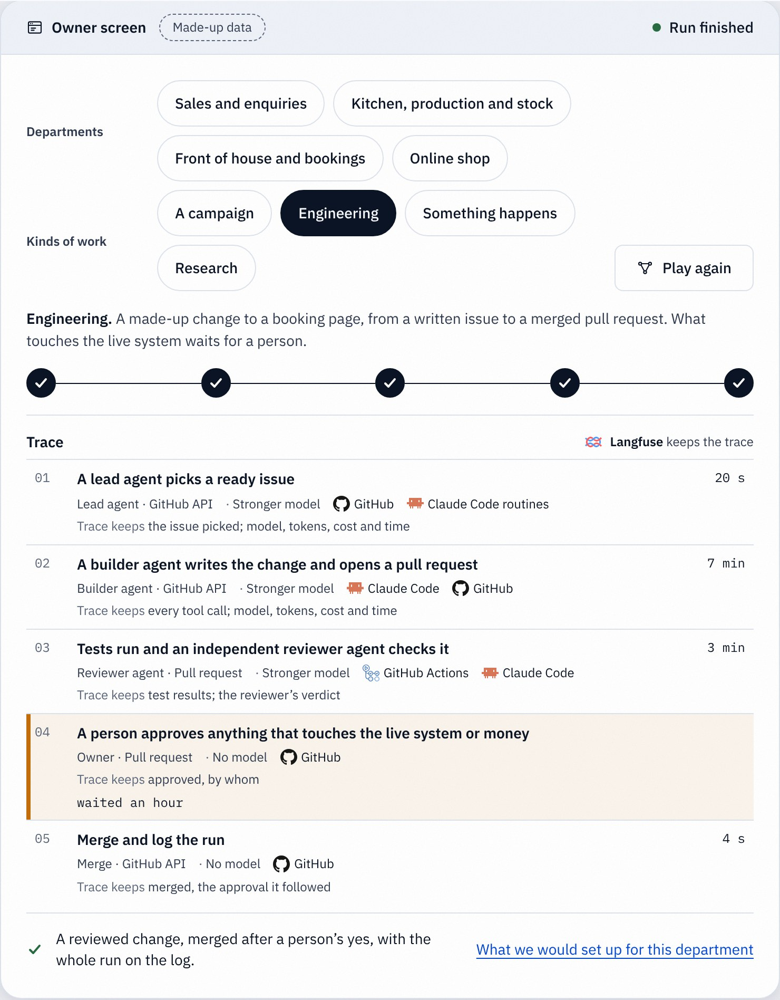
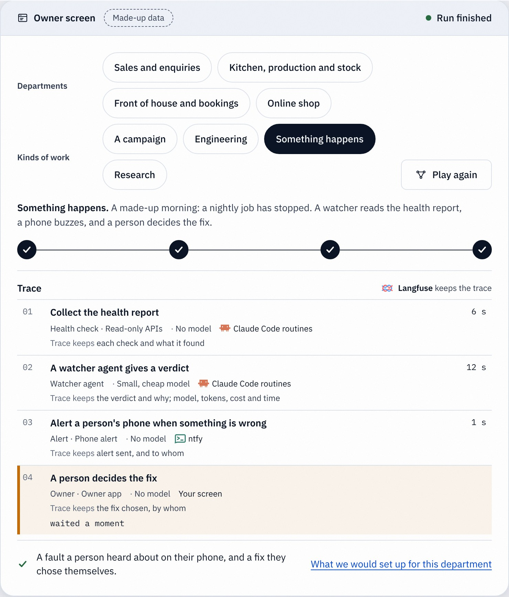
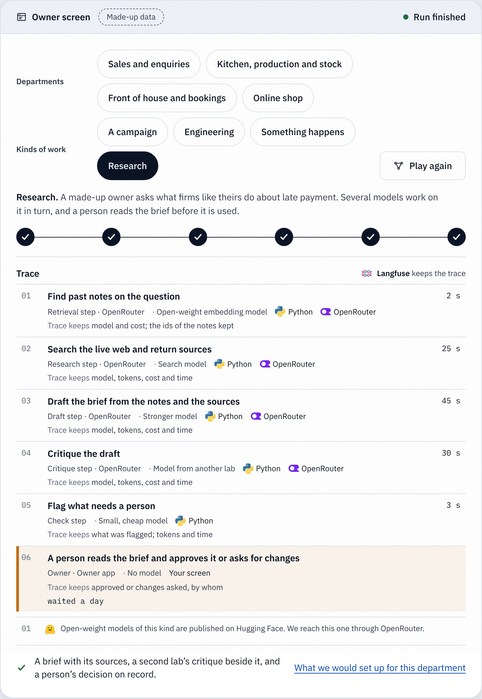
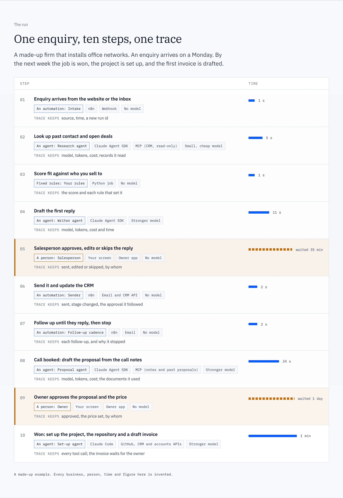

# Example runs

Every business here is made up. These are pictures of the run screen from our own site: each step shows who does it, the kind of model if it uses one, the software it touches and what the trace keeps.

## A campaign

A made-up café plans next month’s campaign. Copy and images are drafted, and nothing is scheduled until the owner says yes.

<picture>
  <source media="(prefers-color-scheme: dark)" srcset="../assets/ui/screen-campaign-dark.jpg">
  
</picture>

## Engineering

An issue becomes a reviewed pull request. A person approves anything that changes the live system.

<picture>
  <source media="(prefers-color-scheme: dark)" srcset="../assets/ui/screen-engineering-dark.jpg">
  
</picture>

## Something happens

A scheduled health report comes in. A watcher gives a verdict, a phone is alerted, and a person decides the fix.

<picture>
  <source media="(prefers-color-scheme: dark)" srcset="../assets/ui/screen-event-dark.jpg">
  
</picture>

## Research with several models

One question, several models in turn through one key with a spending cap, and a person reads the brief before it is used.

<picture>
  <source media="(prefers-color-scheme: dark)" srcset="../assets/ui/screen-research-dark.jpg">
  
</picture>

Open-weight models, such as the embedding model in the first research step, are the kind published on Hugging Face. We reach ours through the router; we do not host or train models.

## A longer run, with its trace

<picture>
  <source media="(prefers-color-scheme: dark)" srcset="../assets/ui/tracerun-dark.jpg">
  
</picture>

