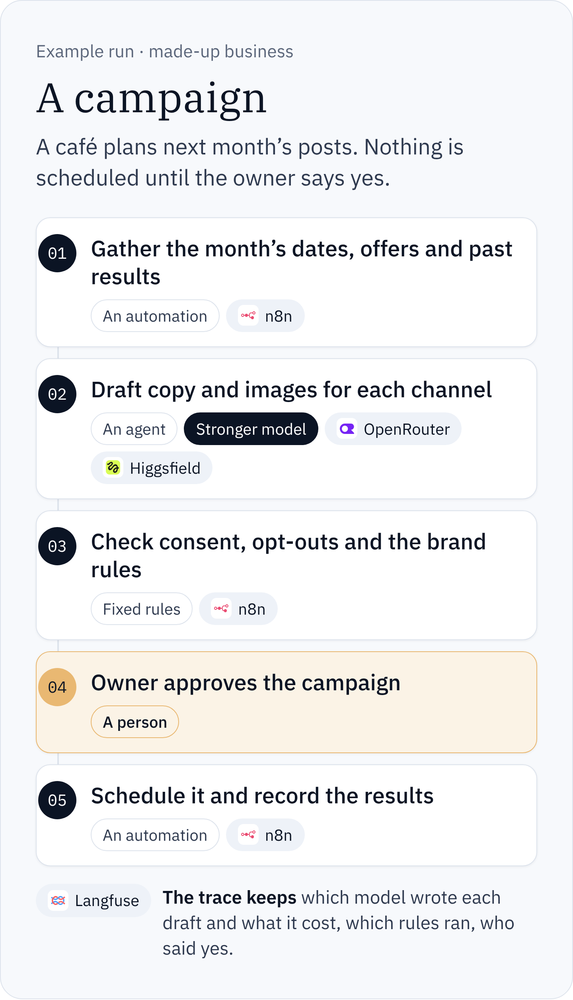
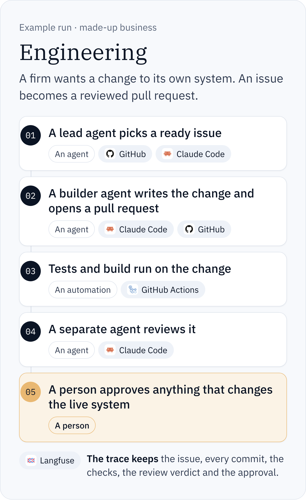
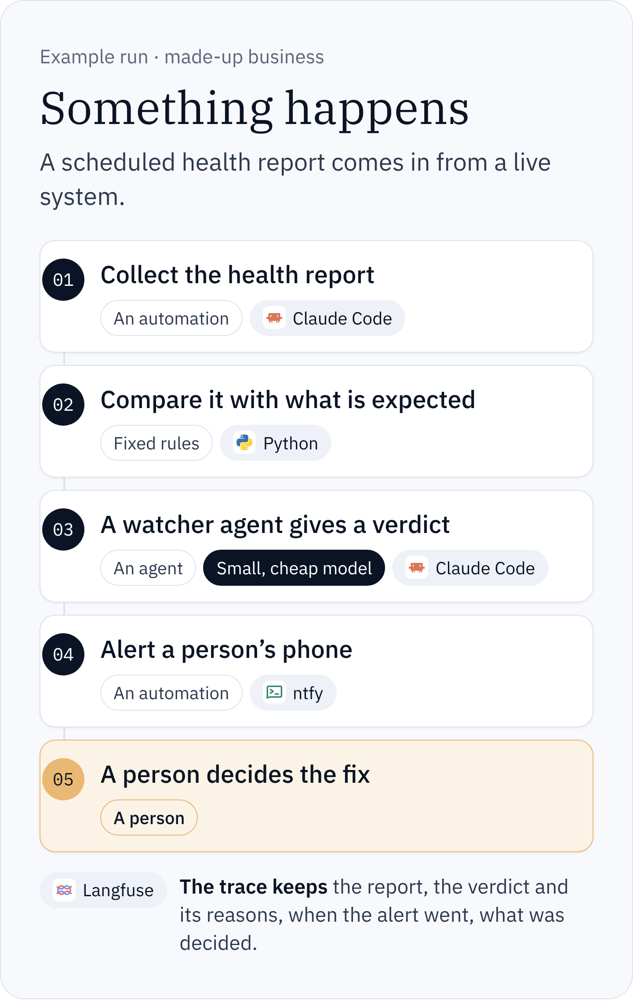
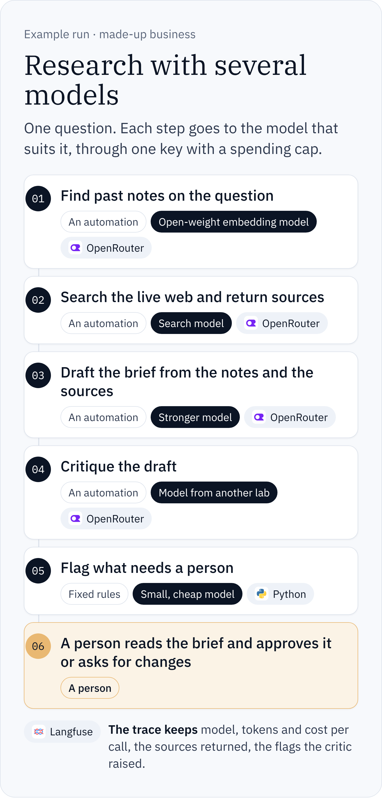
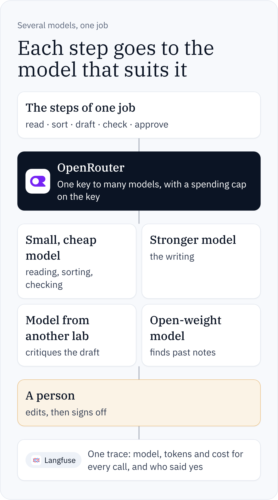

# Example runs

Every business here is made up. The shapes are the ones we set up and run. Each step shows who does it (an automation, fixed rules, an agent or a person), the kind of model if it uses one, and the software it touches.

## A campaign

<picture>
  <source media="(prefers-color-scheme: dark)" srcset="../assets/run-campaign-dark.png">
  
</picture>

## Engineering

<picture>
  <source media="(prefers-color-scheme: dark)" srcset="../assets/run-engineering-dark.png">
  
</picture>

## Something happens

<picture>
  <source media="(prefers-color-scheme: dark)" srcset="../assets/run-event-dark.png">
  
</picture>

## Research with several models

<picture>
  <source media="(prefers-color-scheme: dark)" srcset="../assets/run-research-dark.png">
  
</picture>

Open-weight models, such as the embedding model in the first step, are the kind published on Hugging Face. We reach ours through the router; we do not host or train models.

## One key, several models

<picture>
  <source media="(prefers-color-scheme: dark)" srcset="../assets/models-dark.png">
  
</picture>

